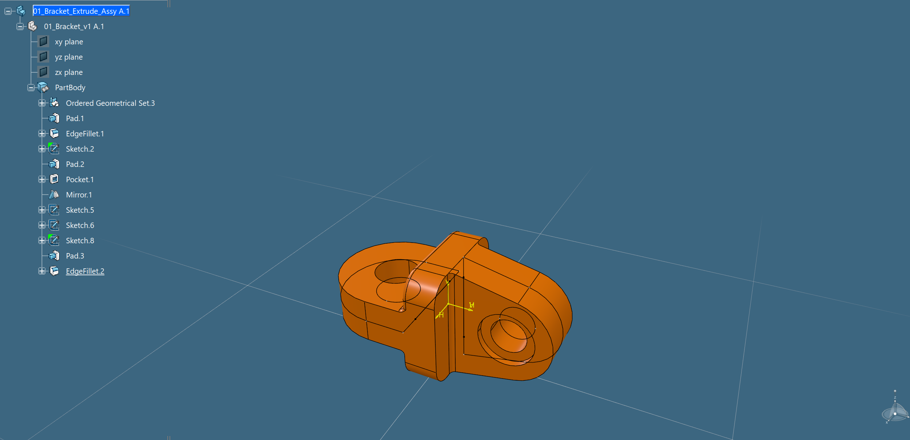

# 01_Bracket_Extrude

## 📌 Model Summary
* **CAD Platform:** 3DEXPERIENCE CATIA (`Part Design`)
* **Assembly / Part Name:** `01_Bracket_Extrude_Assy` / `01_Bracket_v1`
* **Key Features Practiced:**
  * 2D Sketching (`Sketch.2`, `Sketch.5`, `Sketch.6`, `Sketch.8`)
  * Solid Extrusion & Cutouts (`Pad.1`, `Pad.2`, `Pad.3`, `Pocket.1`)
  * Symmetry & Edge Finishing (`Mirror.1`, `EdgeFillet.1`, `EdgeFillet.2`)
* **Reference Tutorial:** [YouTube CATIA Tutorial](https://www.youtube.com/watch?v=7rEHIp5yh9Q)
